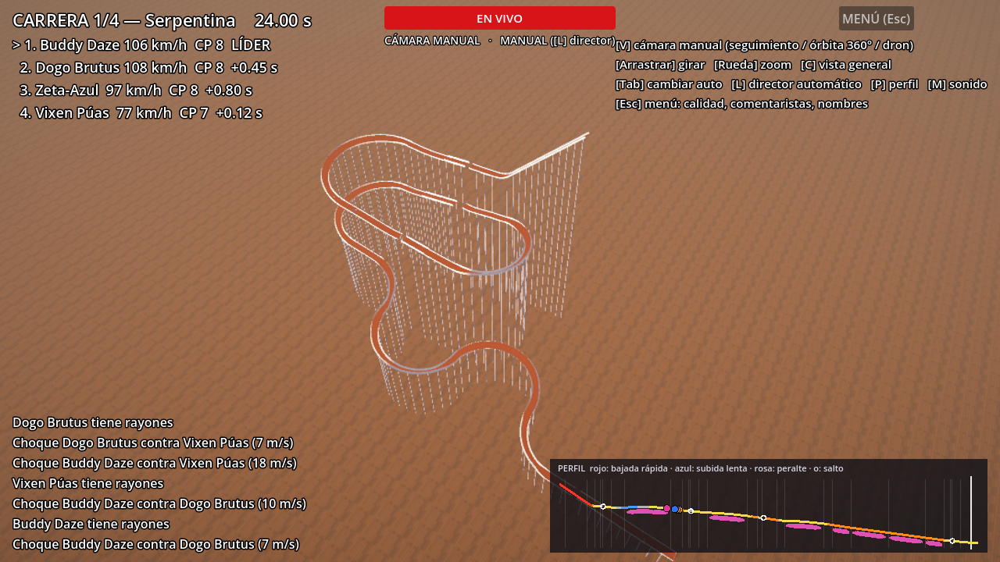
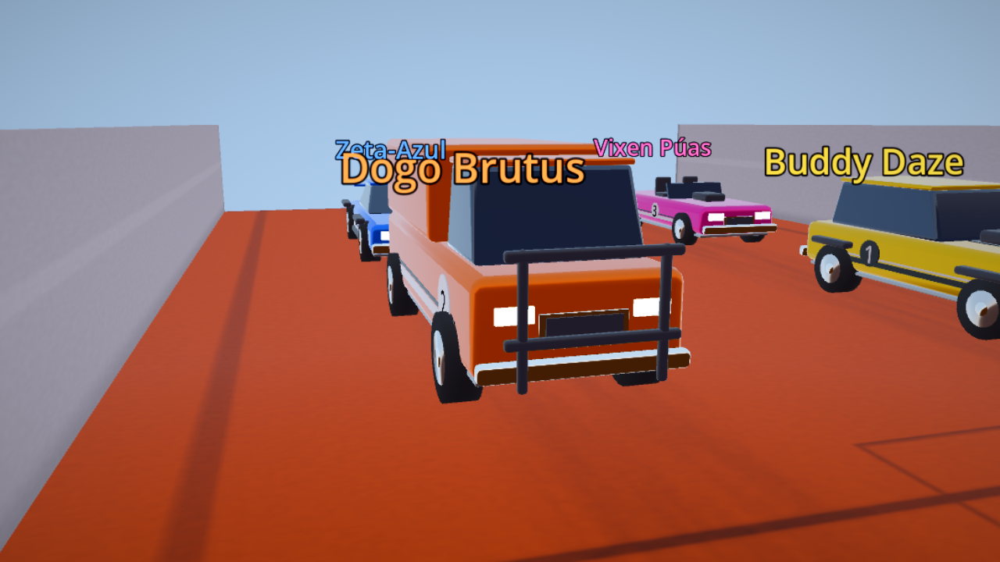

# Shito Racer 3D

Carreras automáticas de autos diecast. Eliges piloto y auto; después **nadie conduce**: la
gravedad, los choques y los vuelcos deciden. Pistas en espiral tipo diorama, locutores con voz,
repeticiones en cámara lenta y un **modo Twitch** en el que el chat de tu stream entra a correr.

## Descargar

**[Descargar para Windows (zip, 39 MB)](../../releases/latest)**: está en la sección *Releases*.

1. Descomprime el zip y abre `ShitoRacer3D.exe`. No hace falta instalar nada.
2. Si Windows muestra "Windows protegió su PC" (el juego no está firmado), pulsa
   **Más información → Ejecutar de todas formas**.

Funciona en PCs sin tarjeta gráfica dedicada (OpenGL 3.3). Si va lento, la calidad baja sola.

También se puede jugar en el navegador: https://shito-racer-3d.escaramuza-salas.workers.dev

## Cómo se juega

- **Garaje:** elige circuito, piloto y modelo. Cada modelo trae fijas sus estadísticas (masa, agarre,
  estabilidad, impulso), que suman lo mismo en todos los autos.
- **Partida:** 4 carreras por puntos, con una parrilla que rota en cada carrera. Los segundos en el
  aire dan puntos extra si llegas a la meta.

| Tecla | Qué hace |
|---|---|
| Esc | Menú: calidad gráfica, locutores, nombres, sonido |
| F11 / Alt+Enter | Pantalla completa |
| V | Cámara manual (seguimiento, órbita o dron) |
| Arrastrar / rueda | Girar la cámara / zoom |
| Tab | Cambiar de auto |
| C | Vista general |
| L | Director automático |
| P · M | Perfil de la pista · sonido |

## Modo Twitch (para streamers)

1. En el garaje pulsa **MODO TWITCH**, escribe tu canal y pulsa **Conectar**.
2. En OBS captura la ventana del juego.
3. El chat entra con:

| Comando | Qué hace |
|---|---|
| `!jugar` (o `!play`, `!join`) | Entra con un auto al azar |
| `!jugar gt` | Entra con ese modelo: van, buggy, proto, roadster, pickup, muscle, hotrod, gt, rally, dragster |
| `!auto <modelo>` | Cambia de auto antes de la salida |
| `!pista 1-4` | Vota el circuito |

Hasta 16 autos por carrera, con ranking de la sesión. La conexión al chat es **anónima y de solo
lectura**: no pide contraseña ni token, y el juego nunca escribe en tu chat.

**Acceso directo a tu canal:** crea un acceso directo al `.exe` y agrega al final del "Destino":
`--twitch=tu_canal`.

## Medir el rendimiento

Abre el juego con `--bench=2` (0 Muy baja, 1 Baja, 2 Media, 3 Alta): corre una carrera sola. Activa
"Mostrar FPS" en el menú (Esc) para ver los FPS en pantalla.

---

Hecho con Godot 4.7 en La Forja · Nuclear Ronin. Todos los derechos reservados.
